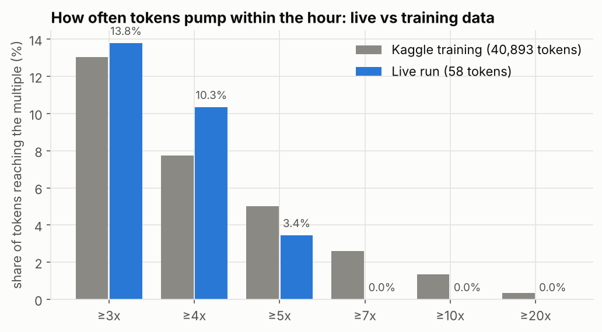
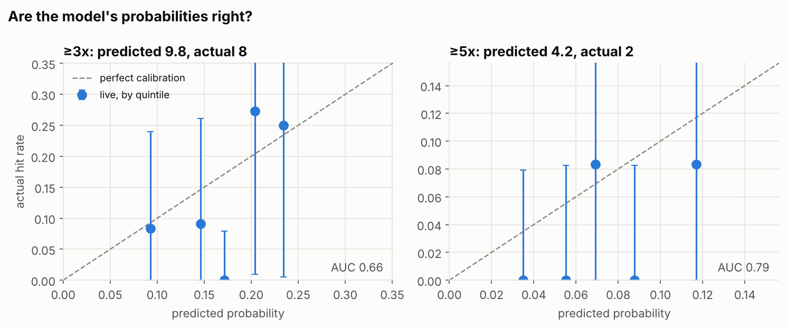
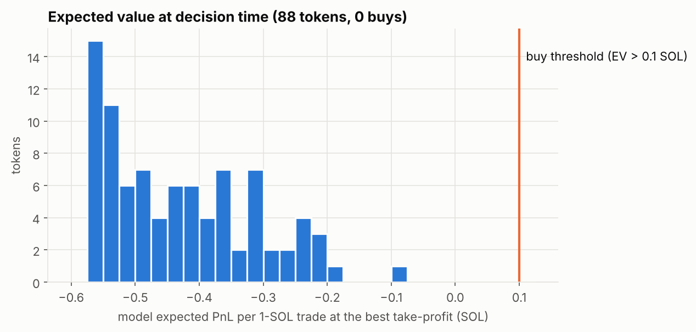
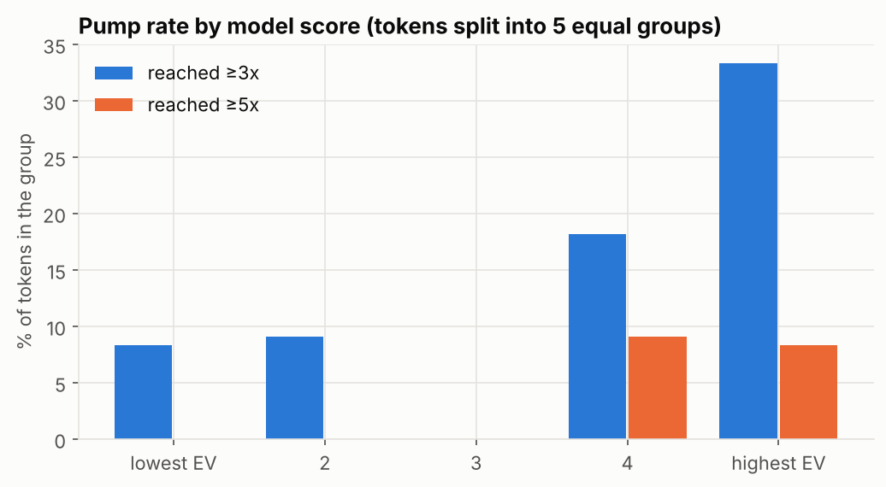
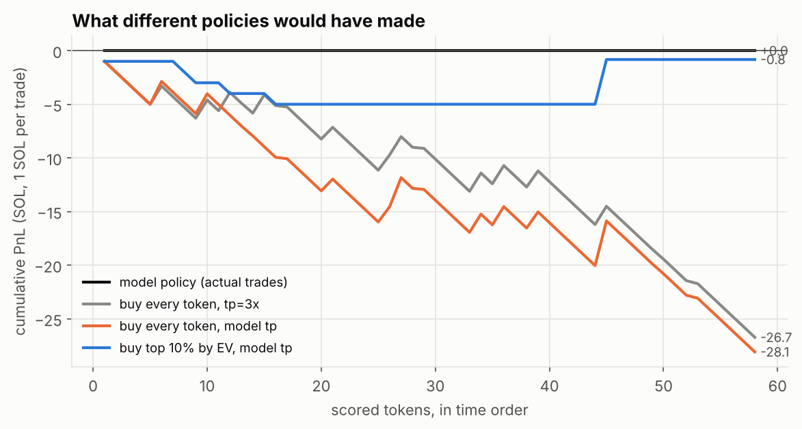
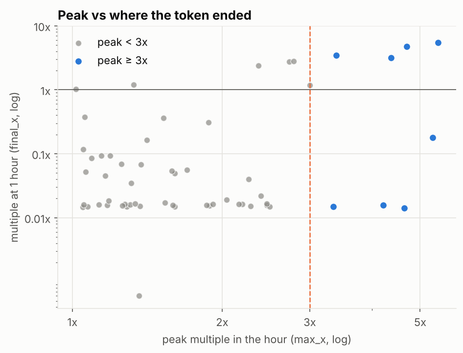
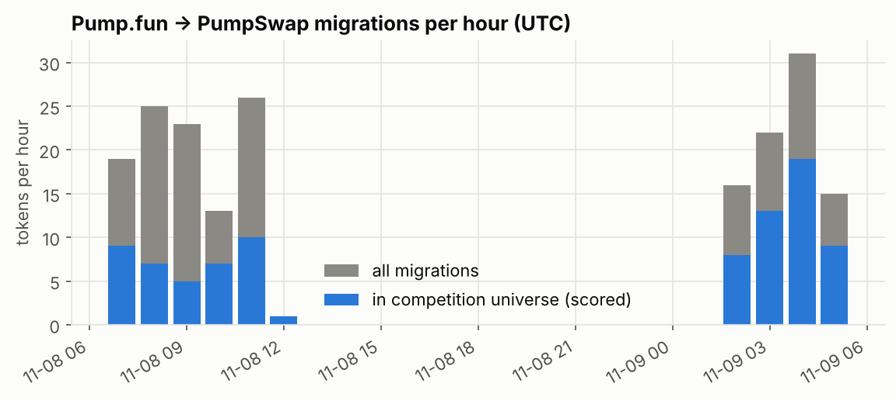

# Live paper-trading results: Nov 8–9, 2026

The v2 model ran on live Solana data from Helius. This is **paper trading**: no transaction was ever sent.
For every token that moved from the pump.fun bonding curve to PumpSwap, the trader:

1. applied the competition's filter;
2. scored the token at t = 60 s;
3. decided whether to buy, and at which take-profit (tp);
4. one hour later, measured what actually happened, using the competition's own labelling.

## Headline

| | |
|---|---|
| Time streamed | **8.5 h** (Nov 8 07:05–12:05 UTC and Nov 9 02:02–05:32 UTC) |
| Migrations seen | 190 |
| Scored (in competition universe) | 88 |
| With a 1-hour result | 58 |
| **Paper buys** | **0**: no token's expected profit cleared the 0.1 SOL threshold |
| Buy every token at tp = 3x | −26.7 SOL over 58 trades |
| Buy every token at the model's tp | −28.1 SOL over 58 trades |

**About the 24-hour run:** it was meant to last 24 hours but stopped after 3.5. At 05:32 UTC on Nov 9 the Helius free plan ran out of credits ("max usage reached"), and the stream was refused from then on. The 5-hour run from Nov 8 is added here so there is more data.

**What was left out:** 8 tokens whose one-hour window was still open when the stream died. Their prices stopped updating, so their results would be wrong.

**Short version:**
- The model's scores rank tokens in the right order, and its probabilities are about right.
- Doing nothing was the right call over these hours: buying anything would have lost money.
- 58 tokens is far too few to say whether the strategy makes money. The backtest needed 42 days and about 150 trades to give a usable answer.

---

## 1. Live tokens pump about as often as in the training data



**What it shows:** the share of tokens whose peak in the hour reached each multiple. Gray is the 40,893 Kaggle tokens; blue is the live tokens.

**Takeaways:**
- The live rates are close to training: 13.8% vs 13.0% reached 3x, and 3.4% vs 5.0% reached 5x.
- Nothing reached 7x. That is expected with 58 tokens: at the training rate of 2.6% you'd expect about 1.5.
- The live market doesn't look different from the period the model was trained on.

## 2. The model's probabilities are about right



**What it shows:**
- Each dot is one fifth of the tokens, grouped by the model's predicted probability.
- The x-axis is the average prediction for that group; the y-axis is how often its tokens actually reached the target.
- Dots on the dashed line mean the model is well calibrated. The vertical bars are 95% uncertainty ranges, which are very wide with only 11–12 tokens per dot.

**Takeaways:**
- **≥3x:** the model expected 9.8 hits and 8 happened.
- **≥5x:** it expected 4.2 and 2 happened. That's slightly low, but well within chance at this sample size.
- **AUC** is the chance that a random token that hit scored higher than one that didn't; 0.5 is a coin flip.
  - Live: 0.66 at 3x and 0.79 at 5x.
  - Backtest: 0.68 and 0.71.

## 3. Why there were no buys



**What it shows:** for each token, the model's expected profit from a 1-SOL trade at its best take-profit:

EV = P(hit) × (tp − 1.3) + P(miss) × expected loss.

The 0.3 SOL competition cost is included. The orange line is the buy threshold of +0.1 SOL.

**Takeaways:**
- Every one of the 88 tokens was below zero. The best was −0.08 and the median −0.44.
- The policy only buys when the odds clearly beat the 0.3 SOL cost and the big losses on misses (most tokens fall to almost nothing).
- In the backtest that happened about 3.5 times a day, so 0 buys in 8.5 hours is plausible.
  - It is a fair warning, though, that live days may often have no trades at all.

## 4. Higher score, more pumps



**What it shows:** tokens split into five equal groups by model score, and the share in each group that reached 3x (blue) and 5x (orange).

**Takeaways:**
- The top two groups had 18–33% reaching 3x, against 0–9% for the bottom three.
- Both 5x hits were in the top two groups.
- So the score does what it should: it pushes the pumps toward the top. The pumps just weren't frequent enough to pay for the many losers.

## 5. What different policies would have made



**What it shows:** running profit and loss at 1 SOL per trade, in the competition's terms:
- a hit pays tp − 1.3;
- a miss pays the final multiple − 1.3, with the loss capped at −1.

**Takeaways:**
- **Buying everything** loses heavily: about −0.5 SOL per token. This is why selecting tokens matters at all.
- **Buying only the top 10% by score** (6 tokens) comes out at −0.8 SOL.
  - Five of the six lost almost all their value.
  - One token was still at 5.5x after the hour, which recovered most of the loss.
- **The actual policy** (black, flat at 0) made no trades and so lost nothing. That was the best result over these hours.

## 6. Pumps rarely last



**What it shows:** each token's peak multiple in the hour (x-axis) against its multiple at the end of the hour (y-axis). Blue tokens peaked at 3x or more.

**Takeaways:**
- 59% of tokens ended the hour below 0.05x, so almost every token loses nearly everything.
- Several tokens that peaked at 4–5x also ended near zero. That is why a take-profit order matters: the gain is only kept if you sell during the spike.
- A few tokens held their gains (top right). These are the ones that make "hold and miss" less painful.

## 7. Market activity



**What it shows:** migrations per hour. Gray is all migrations; blue is those that passed the competition filter: pool ≥ 60 SOL, ≥ 100 trades in the first minute, token age ≤ 30 days.

**Takeaways:**
- About 13–31 migrations an hour, of which 5–19 were in the universe.
- The gap is the time between the two runs, when nothing was streaming.

---

## Data quality

**Checked against Kaggle and the chain:**
- The live features were checked against the Kaggle data: decoded trades, price formula, creation-transaction features and the universe filter all matched 100% on the sampled tokens.
- The stream was checked against the chain's own transaction history; the trade counts matched.

**During these runs:**
- **Reconnects:** the connection dropped 10 times, each time reconnecting within about 3 seconds. 5 scored tokens had a reconnect inside their first minute (`stream_gap = 1` in `decisions.csv`).
- **Missing features:** 8 tokens had one feature missing, usually because the creator's transaction could not be fetched.
- **Fill price:** the price about 2 s after each decision was a median 0.8% above the decision price, so a realistic fill would barely change the numbers.

## Files

| File | Contents |
|---|---|
| `decisions.csv` | One row per scored token: entry price, EV, calibrated probabilities `p_3`–`p_20`, data-quality flags; the `run` column says which run it came from |
| `outcomes.csv` | One-hour result per token: `max_x` (trimmed peak), `raw_max_x`, `final_x`, paper `pnl` |
| `summary.json` | All the numbers quoted above |

To regenerate the charts from a run folder:

```bash
python live/report.py live/runs/<run> live/reports/<name>
```

## Next steps

- **Get a longer run.** It needs a Helius plan with enough credits, or any Solana RPC that supports `logsSubscribe`. The stream is about 900 transactions/s and used up the free plan's credits after about 10 hours of streaming in total.
- **At least 2–3 weeks** (about 50–100 paper buys) are needed before the live profit means anything. The backtest's 95% range over 42 days was −28 to +94 SOL.
